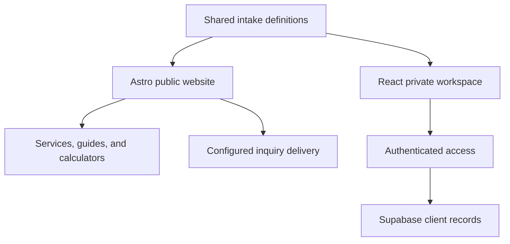

## The brief

Adamou Financial Consulting needed a public presence that made financial coaching feel understandable and approachable. The website introduces Matt’s services, offers practical planning tools, and gives prospective clients a structured way to explain what they need.

The wider project also includes a private client workspace. That creates two distinct audiences: people deciding whether to start coaching, and the person managing ongoing client relationships. The public website and internal application share a project, but their responsibilities and access rules remain separate.

## Brand ideation

The Afin identity builds on a mountain mark redrawn from the supplied business card. The mountain is a useful organizing idea for the experience: a path forward, with progress made in manageable steps. A locally hosted mountain-path photograph carries that theme into the homepage.

The copy and visual system aim for clarity rather than urgency. Financial conversations can already feel complicated; the interface should make services and next steps easier to understand.

| Element           | Treatment                         | Purpose                                                      |
| ----------------- | --------------------------------- | ------------------------------------------------------------ |
| Primary color     | Deep blue, `#204F60`              | Anchor text and calls to action                              |
| Background        | Warm paper, `#F7F4EB`             | Create a calm reading surface                                |
| Supporting colors | Sage `#78978E` and sand `#E7C78C` | Add warmth to illustrations and accents                      |
| Headlines         | Georgia                           | Give the identity an established, personal feel              |
| Body copy         | System sans-serif                 | Keep the interface familiar and avoid external font requests |

The brand guide explicitly avoids pressure, invented credentials, and promises of specific financial outcomes. That is a content decision as much as a design decision. Service information comes from supplied material rather than inferred biography.

## A useful public experience

Sixteen financial calculators and supporting guides provide ways to explore a question before making contact. The tools sit alongside service explanations and intake rather than replacing the coaching proposition.

The intake is a bridge between a public visit and a more informed conversation. Shared field definitions and validation keep its structure aligned with the internal workspace. The aim is to reduce ambiguity about what information is needed, while maintaining a clear distinction between collecting an inquiry and beginning a client relationship.

## Technical approach

The repository is a Bun monorepo. Astro serves the public website, with React used where interaction is needed. A separate React application supports client records, onboarding, goals, follow-ups, offboarding, and business reporting. A shared intake package keeps common definitions in one place.

Supabase enforces access to the private client data. The workspace documentation makes an important deployment boundary clear: production client access stays disabled until the required services are connected. A built interface is not the same thing as a configured production workflow.

TypeScript, Flox, browser tests, and shared verification commands support development across both applications. Keeping the two applications separate also allows public content to stay simple without forcing private workflows into the marketing site.

## Codex and agentic use

Codex supported the design and implementation work. The project illustrates how that assistance can span presentation and application structure: from the public-facing visual direction to the organization of a shared codebase. The resulting experience still needs review against the actual coaching workflow and the boundaries around private information.

is-agentic was used to improve how agents discover and crawl the public site. Complete HTML, canonical URLs, structured metadata, a sitemap, and agent indexes make the public offering easier to interpret. Markdown copies are generated from the same HTML content, avoiding a second body of copy that could drift out of date.

Agent access does not extend to private client records. The public discovery documentation does not advertise a payment API, MCP server, or booking availability. It also distinguishes an email draft from a delivered inquiry. These boundaries help an assistant describe the site accurately rather than infer capabilities from a contact form.

## Delivery and lessons

The project brings together a calm public identity, practical calculators, a structured intake, and a separate workspace for ongoing operations. Its scope is broader than a brochure, but the public visitor does not have to understand that internal complexity.

The main lesson is to design the public and private experiences around different jobs. Prospective clients need clarity and a sensible next step; internal work needs consistent records and controlled access. Shared definitions can connect those experiences without exposing the private application. This case study describes the implemented system, not a claim about revenue, client retention, or financial results.
