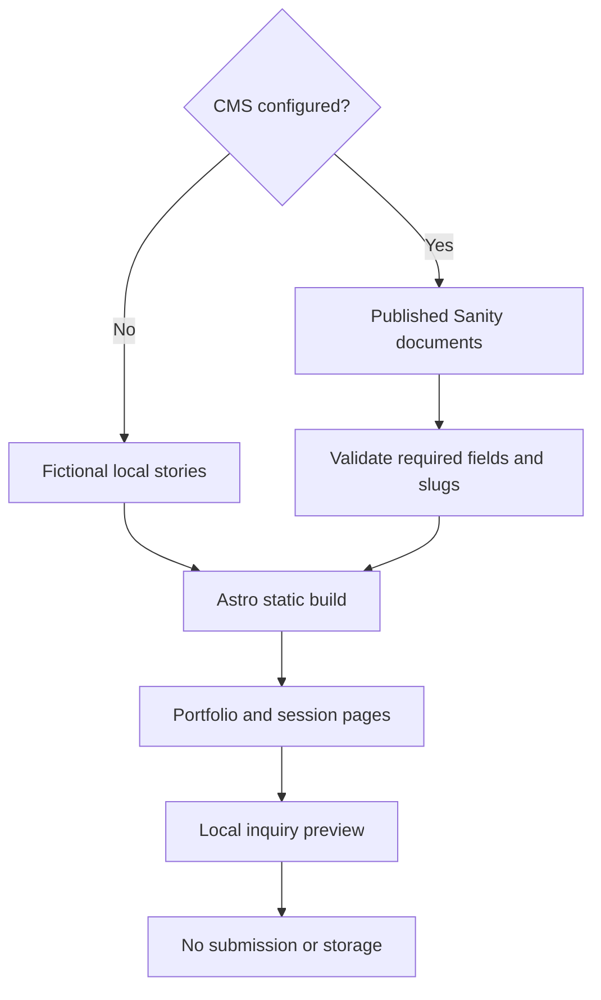

## The brief

Alder House is a fictional photography studio and a concept project. It explores how a portrait and lifestyle photography website can combine an expressive visual identity with a practical path from browsing photographs to planning a session.

The demonstration covers portraits, families, brands, and celebrations. It includes an editorial homepage, portfolio stories, dedicated session guides, six planning tools, and an inquiry preview. The site is explicit about its demo status: the inquiry does not submit or store personal information.

## Brand ideation

The identity uses the language of a small, considered photography studio. Warm paper, muted green, generous image areas, and an elegant serif create space for the photographs. The interface remains restrained so the work, rather than decorative UI, receives the most attention.

“Portraits that feel like you” gives the homepage a human focus. The surrounding copy explains planning and direction, helping a visitor imagine the experience of a session instead of only evaluating a gallery of finished images.

| Element            | Treatment                       | Purpose                                       |
| ------------------ | ------------------------------- | --------------------------------------------- |
| Background         | Warm paper, `#F6F3EC`           | Establish an editorial surface                |
| Primary text       | Deep green, `#303A2D`           | Give the identity a natural, quieter contrast |
| Supporting surface | Sage, `#E5E7DA`                 | Group content without heavy visual framing    |
| Headlines          | Italiana, with Georgia fallback | Create a distinctive studio voice             |
| Body copy          | DM Sans                         | Keep planning guidance readable               |

The monogram, wordmark, photography, and circular stamp form a recognizable system across the homepage and social preview. These are elements of a concept identity, not evidence of a studio’s trading history or client endorsements.

## Designing around the session

A photography website has two complementary jobs: show the work and help someone understand what working together might involve. Alder House gives both responsibilities space.

Portfolio stories provide a more considered context than an undifferentiated image grid. Session pages explain the different types of photography and the planning involved. The tools give visitors a way to explore practical questions before reaching the inquiry.

The inquiry is intentionally a local preview. It demonstrates the interaction and information structure without pretending that a booking has been sent. A real studio launch would need a separately configured delivery workflow and reviewed business details.

## Technical approach

Astro renders static pages. Sanity manages portfolio stories and studio copy, while source-managed session data supplies the detailed planning guides. React is used by Sanity Studio rather than added as a requirement for the public editorial experience.

CMS content is fetched at build time. A configured CMS that returns invalid data stops the build; it does not silently switch to demo stories. With no CMS configured, the local fictional content provides an explicit demonstration mode.

The project avoids a general-purpose page builder. Shared story cards, layouts, and session guidance provide consistency while keeping the implementation focused. Flox, Bun, browser tests, and accessibility checks support the development workflow.

## Codex and agentic use

Codex was used in the design and implementation process. The work includes translating a studio concept into a coherent interface, connecting that interface to structured content, and refining the interactions around portfolio exploration and session planning.

is-agentic was used to guide improvements to discovery and crawlability. The build generates a sitemap, robots rules, agent indexes, and Markdown copies from the rendered public pages, including published CMS galleries. The Studio editor stays outside that public content index.

The agent-facing representation also preserves the project’s fictional status. It does not invent a business address, live booking availability, or contact details. Planning calculations still require a browser, and the local inquiry preview is not described as a submission API.

## Delivery and lessons

The delivered concept demonstrates a complete visual and content system: portfolio presentation, session guidance, planning tools, CMS-backed stories, and a carefully bounded inquiry experience.

The main lesson is that an image-led website still benefits from strong information architecture. Photographs establish interest; guidance helps a visitor decide what to do next. The concept shows that relationship without claiming live bookings, paying customers, or measured conversion results.
