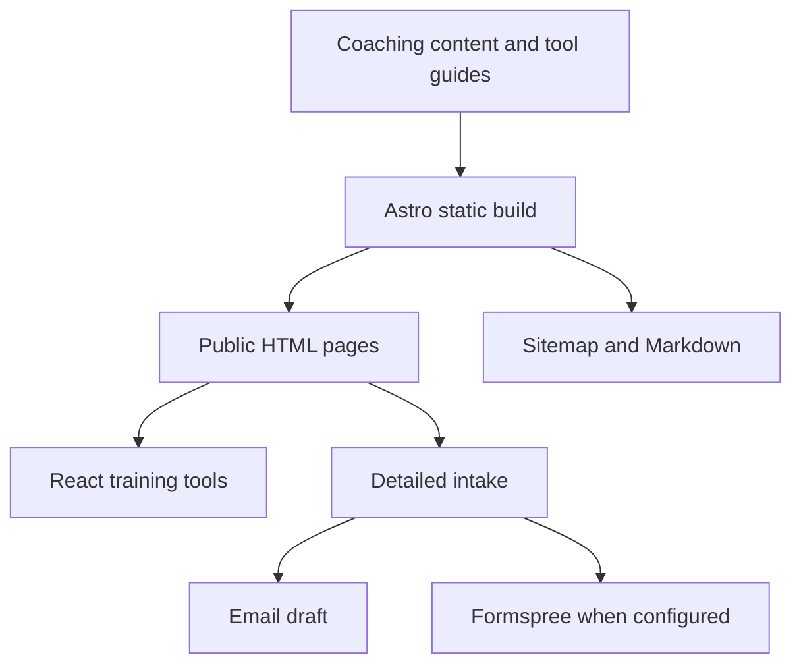

## The brief

A personal-training website has to communicate more than a list of exercises. It needs to introduce the coach, make the approach understandable, and help a visitor decide whether they want to start a conversation. Bold Performance brings those responsibilities together for Brock Jones’s coaching practice in Scottsdale, Arizona.

The site combines a public introduction with dedicated coaching pages, a searchable training toolkit, and a detailed intake. That structure gives someone who is ready to inquire a direct route forward, while leaving room for visitors who first want to understand the work.

## Brand ideation

The visual direction pairs the energy of a training environment with a practical, readable interface. Large condensed headlines create a strong first impression; quieter body typography gives coaching explanations and tool instructions room to breathe. The gym photography establishes the setting without asking decorative effects to carry the message.

The guiding design idea is a clear progression from ambition to action. “Built for more. Trained for life.” introduces the coaching proposition, while the surrounding service descriptions, credentials, and calls to action give that proposition substance.

| Element        | Treatment                | Purpose                                   |
| -------------- | ------------------------ | ----------------------------------------- |
| Primary accent | Cyan, `#55B4C9`          | Draw attention to actions and key details |
| Text           | Deep charcoal, `#161C1D` | Maintain strong contrast                  |
| Background     | Off-white, `#F6F6F1`     | Give the content a calmer reading surface |
| Headlines      | Barlow Condensed         | Establish a direct, athletic tone         |
| Body copy      | DM Sans                  | Keep longer explanations approachable     |

The same direction extends to the logo assets and social preview. Those pieces make a shared link feel connected to the website rather than like an unrelated promotional graphic.

## From introduction to inquiry

The navigation separates coaching information from practical tools. A visitor can read about the coach, explore a relevant service, or use the toolkit before deciding whether to reach out. Twenty searchable training tools make the site useful beyond the first visit.

The intake gathers context before a conversation begins. Its delivery behavior is deliberately explicit: the site can prepare an email draft, or send through Formspree when configured. Preparing a draft is not treated as a successful submission. That distinction matters when a potential client is trusting the website with their next step.

## Technical approach

Astro serves the content as static pages. React is reserved for the interactive toolkit, keeping the informational experience independent of a large client application. TypeScript supports the implementation, Bun runs the development and verification commands, and Flox defines a repeatable environment.

The architecture separates content delivery from interaction and inquiry handling:

This division makes routine content updates straightforward while preserving richer behavior where it is useful. Vercel hosts the output and deploys changes from the main branch. The repository’s shared checks cover formatting, documentation, validation, tests, and the production build.

## Codex and agentic use

Codex was used in the design and implementation workflow: working through the site’s presentation and translating the intended experience into code. The useful unit of review remained the actual website—its content, interactions, and rendered pages—not simply whether generated code compiled.

The other side of agentic work was making the finished website understandable to agents. is-agentic was used to guide improvements to discovery and crawlability. The site provides a sitemap, robots rules, `llms.txt`, and `llms-full.txt`. Markdown is generated from the rendered content, so the machine-readable version follows the information visitors see.

Vercel middleware handles requests for `text/markdown`; ordinary browser visits receive HTML. Tool calculations still run locally in the browser. The site does not advertise a booking or payment API that an agent could mistake for an available capability.

## Delivery and lessons

The delivered experience connects positioning, useful tools, and a clear inquiry path. It also includes responsive layouts, social metadata, and documentation for maintaining the site.

The central lesson is that a service website becomes more useful when visitors can do something relevant before contacting the business. The training tools support that idea without obscuring the main purpose: introducing the coach and helping someone take a considered next step. Conversion uplift and coaching outcomes are not claimed here; those require evidence beyond the implementation itself.
