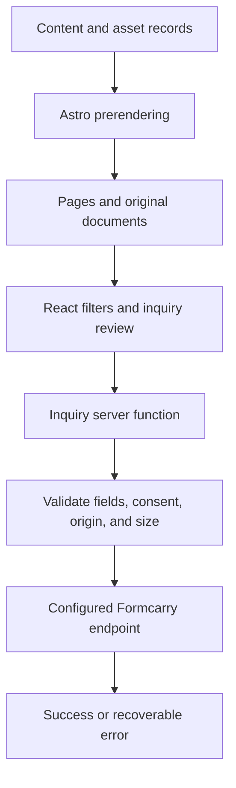

## The brief

JEA BizDev Consulting’s website needs to communicate specialized life-sciences expertise while making opportunities and supporting material easy to explore. The audience is evaluating professional credibility, relevant assets, and whether a conversation makes sense.

The work combines an editorial introduction with partnering assets, transaction announcements, source documents, and a guided inquiry flow. The goal is to make that information accessible without flattening the business into a generic consulting template.

## Brand ideation

This project preserves an established identity. The JEA name, blue DNA mark, and blue palette remain recognizable, while the surrounding layout adopts a more editorial treatment.

Georgia headlines provide contrast with locally hosted Geist body text. Supporting navy panels create hierarchy around evidence, the contact band, and the footer. The effect is a professional visual system that can accommodate both a short introduction and denser technical material.

| Element         | Treatment               | Purpose                                            |
| --------------- | ----------------------- | -------------------------------------------------- |
| Primary blue    | `#2563EB`               | Preserve the established identity                  |
| Supporting navy | `#172B50` and `#111F38` | Frame key information and closing sections         |
| Light surface   | White and `#EFF6FF`     | Keep documents and listings readable               |
| Brand mark      | Existing DNA geometry   | Retain continuity with the source identity         |
| Typography      | Georgia and Geist       | Balance editorial character with interface clarity |

The supplied handshake photograph communicates partnership. It is not presented as evidence of a particular transaction. Likewise, the adjacent career information belongs to the consultant’s track record, rather than being a result attributed to the website redesign.

## Organizing specialist content

The site gives partnering opportunities their own structure instead of asking visitors to search through a long homepage. Filtering and detail pages help a reader move from a broad area of interest to a specific asset and its supporting documents.

Original PDFs and source material remain part of the experience. That matters for a specialist audience: a polished summary is useful, but it should not replace the underlying material when a visitor needs more detail.

The guided inquiry flow then provides a next step. It collects context, presents controls appropriate to the form, and returns a clear status after submission. A direct email option remains available for visitors who need another route.

## Technical approach

Astro prerenders public pages. React islands supply state for asset filtering, select controls, and inquiry review. Smaller browser scripts handle navigation, search, and directory behavior. This keeps the reading experience available without requiring the entire site to become a client-rendered application.

The inquiry provider URL remains server-side. Validation and delivery are separate from the form’s presentation, making failures easier to handle explicitly. Browser tests mock the endpoint, while unit tests cover validation and provider errors.

Bun and Flox support a repeatable development workflow. The shared quality gate covers types, source budgets, documentation and Mermaid validation, production output, links, and desktop and mobile journeys.

## Codex and agentic use

Codex was used during design and implementation. In this project, a central constraint was preserving recognizable brand material and source documents while improving how the information is presented. Agent assistance is useful only when the resulting pages remain faithful to that source material.

is-agentic was used to guide discoverability and crawlability improvements. Public content is prerendered, so an agent does not need to run the interactive filters just to read the site. The repository also includes an `llms.txt` guide that points agents toward relevant information.

The interactive layer and the discoverable content serve different purposes. Filters help a person narrow a list; static detail pages and documents provide stable destinations to read and reference. The case study does not imply that an agent can negotiate a transaction or submit an inquiry without a visitor’s instruction.

## Delivery and lessons

The resulting site connects a recognizable identity with a more navigable body of specialist material. Its useful features include opportunity exploration, supporting documents, a clearer inquiry path, and explicit submission feedback.

The main lesson is to treat credibility as a relationship between presentation and evidence. Strong typography and hierarchy can help visitors find the right material, but the underlying facts and documents still do the substantive work. Transaction outcomes and commercial impact are not attributed to the redesign without separate evidence.
