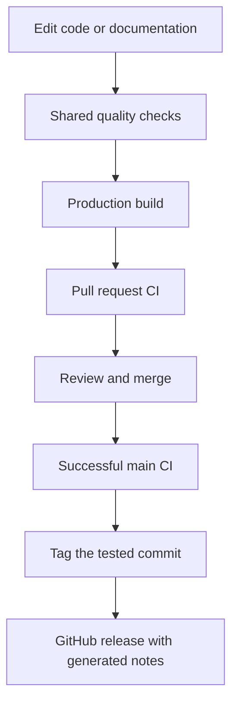

# Quality and releases

## One development environment

Run `flox activate` before installing dependencies or running checks. The committed
Flox manifest and lock provide Bun, Node 24, Python, pre-commit, and ShellCheck on
macOS and Linux. Use `flox activate --start-services` to start the development
server, then `flox services stop web` to stop it. CI activates the same environment.

The React Hooks ESLint plugin remains pinned to the existing 7.0.1 ruleset;
upgrading compiler diagnostics is a separate refactoring task.

Vercel uses the commands in `vercel.json` and detects Bun from `bun.lock`.
The `packageManager` field is omitted because the existing Vercel Corepack
setting does not support Bun. Flox supplies the development/CI version.

Bun installs from `bun.lock`; Node runs Next.js and Vitest through their normal
entry points. Update dependencies deliberately and commit the lockfile.

## Local gates

`bun install` enables Husky. `bun run check` runs ESLint, TypeScript, Prettier,
Markdown lint, Mermaid parsing, the LOC budget, and tests. Pre-commit runs this
same command; pre-push builds production output. Users of the Python pre-commit
runner can run `pre-commit run --all-files` with the supplied configuration; keep
Husky as the installed Git hook to avoid competing hook managers.

`.loc-budget.json` counts nonblank JavaScript and TypeScript lines in `src/` and
`scripts/`, including tests. New files have a 300-line limit. Existing larger files
have explicit limits. The total leaves a small growth allowance. Simplify or split
responsibilities before increasing a limit; justify changes during review.

## CI and releases

CI runs on pull requests and pushes. Formatting, security auditing, documentation,
and shell checks are blocking. Coverage is generated once and retained as an
artifact. Documentation builds with MkDocs strict mode.

The release workflow runs only after successful push CI on `main`, checks out the
exact tested SHA, and skips it if `main` has moved. It reuses a tag already pointing
to that SHA, otherwise increments the latest stable patch tag (starting at
`v0.1.0`). Releases contain generated notes. Concurrent releases are serialized;
rerunning the workflow recovers a tag whose release creation was interrupted.

Branch CI never publishes a release. Repository administrators should require CI
before merging and enable the desired GitHub Pages deployment environment.

## Temporary dependency exception

The audit has one explicit exception, **CVE-2026-93687** in `braces` 3.0.3.
[The upstream advisory](https://github.com/advisories/GHSA-vfj7-8cjw-p6xm)
lists no patched version as of October 13, 2026. It affects recursive expansion of
untrusted glob patterns; this dependency is used by ESLint and Markdown lint with
repository-controlled patterns, not by the site's request handlers. All other
high and critical advisories fail CI. `bun run audit` prints the exception and
fails after November 13, 2026 until it is reviewed. Remove the exception when a
patched dependency is available. Do not expose these tooling glob parsers to
visitor input.
