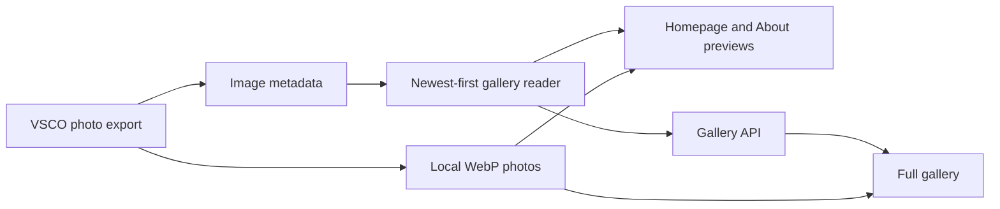

# Gallery integration

The homepage and About page show the four most recently uploaded photographs
from the same export used by `/gallery`. The full gallery provides infinite
scroll and a lightbox. Photos are hosted with the site, so viewing them does not
depend on VSCO's CDN.

The gallery is always available; no feature flag or VSCO credential is required.

## Photo storage

- Metadata: `data/vsco-export.json`.
- Images: `public/images/vsco/<image-id>.webp`.
- Reader: `src/lib/vsco-local.ts` removes videos and duplicate IDs, then sorts by
  `upload_date`, newest first.
- Homepage and About: receive the first four entries during server rendering.
- Gallery: `/api/vsco` provides paginated entries for `useInfiniteVscoGallery`.
- Next.js creates responsive image sizes; the lightbox opens the local WebP.

## Refreshing photos

Request a photo export from your VSCO account and download the ZIP. Use only
`images.json` and entries under `images/`; other files contain account data and
must not be published.

**Do not extract photos by filename alone.** VSCO can put several different
photos in ZIP entries with the same filename. Match each entry's MD5 digest to
`file_hash` in the image metadata, and verify `file_size`, before naming the
result with its unique image `id`.

Convert matched photos to WebP (quality 82, longest edge up to 1600 pixels,
without enlargement). Apply orientation and omit embedded EXIF metadata. Save
as `public/images/vsco/<id>.webp`, update `data/vsco-export.json`, and ensure every
non-video entry has a corresponding file before deploying. Keep original photo
files outside the repository.

Run `bun run check` and `bun run build`. Verify the first four homepage photos
match the gallery's newest entries, including multiple images with the same
original filename. A deployment updates the metadata and photos together.
