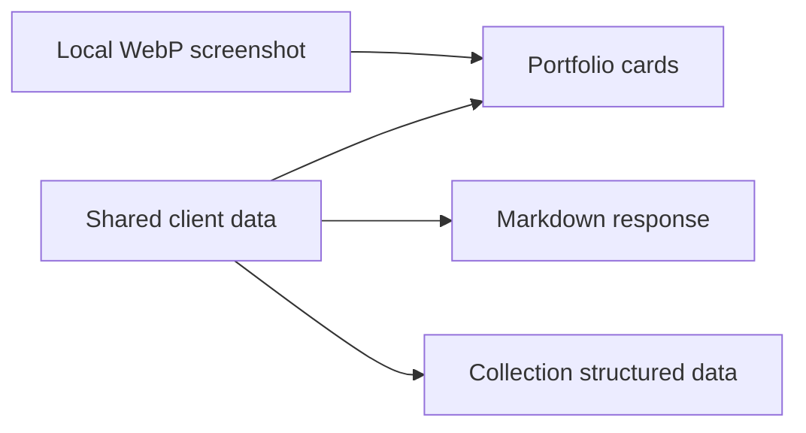

# Client work

The [client portfolio](https://nicholasadamou.com/clients) introduces four projects.
Cards on the homepage and portfolio open individual case studies with brand
ideation, technical decisions, Codex and is-agentic use, a Mermaid diagram,
related work, and a project inquiry CTA. Alder House is a fictional studio concept.
Use **Visit website** to open the live site in a new tab.

## Maintain the portfolio

1. Edit `src/lib/content/clients.ts` to add or update a name, category, description, and URL.
2. Run `bunx playwright install chromium`, then `bun run capture:clients`. The capture waits for fonts, visible images, and entrance animations.
3. Save a WebP at `public/images/clients/<slug>.webp`. Avoid personal or private content.
4. Review `/clients` on desktop and mobile, including keyboard focus and image alt text.
5. Run `bun run check` and `bun run build`.

The page uses local images with explicit dimensions, responsive sizing, and
content-hashed URLs so refreshed screenshots cannot reuse stale optimized images. The
first image is preloaded; subsequent images load lazily. No live screenshot
service or third-party image request is needed when someone visits the page.

## Write a case study

Add `content/clients/<slug>.md` with a `stack` array in YAML frontmatter.
Cover the brief, brand direction, visitor experience, technical approach,
agentic use, and lessons. Use one fenced Mermaid diagram with a prose explanation.
Register the screenshot import in `src/lib/content/client-images.ts`.

Verify claims against project documentation and owner feedback. Distinguish
concepts and configured integrations from delivered features and measured results.
The initial studies use the projects' READMEs, brand guides, and architecture and
discovery documentation. Codex and is-agentic usage was confirmed by the owner.
Do not infer conversion rates, revenue, audit scores, or time savings.

Studies use the notes reading width and table of contents. They are statically
generated with social metadata and sitemap entries. Requests with
`Accept: text/markdown` receive the study text; unknown slugs return 404.
Mermaid loads only for diagrams, using strict rendering. Source remains available
without JavaScript or on a rendering error. Markdown and Mermaid validation run
in local checks and CI. Check desktop and mobile layouts before publishing.

## Technology marks

Stack badges use locally hosted monochrome SVG masks, with the technology name
remaining visible text. Astro, React, TypeScript, Bun, Vercel, Sanity, and Supabase
marks come from [Simple Icons](https://github.com/simple-icons/simple-icons),
under [CC0](https://github.com/simple-icons/simple-icons/blob/develop/LICENSE.md).
The Flox mark comes from its [official favicon](https://flox.dev/favicon.svg),
with the background removed and its path rendered in monochrome. Brand marks
identify technologies; they do not imply endorsement. Add new assets under
`public/brands/technology/` and register their names in the case-study component.

## Visual brand sections

Each case study includes locally hosted logo variants and a social preview from
its project’s brand page. Palette names, typography pairings, and usage notes live
in `content/clients/brands.json`; the shared `BrandShowcase` component renders them.
The case-study renderer inserts this visual after the Brand ideation heading;
the original Markdown remains readable as prose and a brand table for agents.

Assets live under `public/brands/clients/<slug>/`. Preserve SVG artwork and its
proportions; export social PNGs to WebP without changing their composition.
Source brand guides are [Bold Performance](https://bold-performance.vercel.app/brand/),
[Afin](https://adamou-financial-consulting.vercel.app/brand/),
[JEA](https://jeabizdev.com/brand/), and [Alder House](https://alder-house.vercel.app/brand/).
Photographs retain their source projects’ credits and terms. The displayed font
names document the pairing; the site’s own typography renders those labels.
