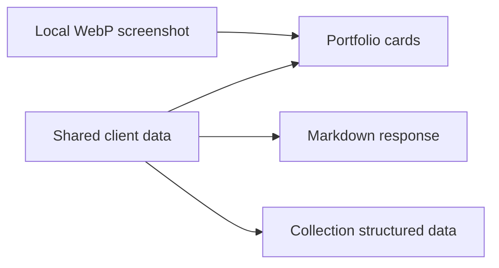

# Client work

The [client portfolio](https://nicholasadamou.com/clients) shows real homepage
screenshots for Bold Performance, Adamou Financial Consulting, and JEA Business
Development. Select a card to visit the live
site in a new tab. Screenshots are snapshots; the live websites may change.

## Maintain the portfolio

1. Edit `src/lib/content/clients.ts` to add or update a name, category, description, and URL.
2. Run `bunx playwright install chromium`, then `bun run capture:clients`. The capture waits for fonts, visible images, and entrance animations.
3. Save a WebP at `public/images/clients/<slug>.webp`. Avoid personal or private content.
4. Review `/clients` on desktop and mobile, including keyboard focus and image alt text.
5. Run `bun run check` and `bun run build`.

The page uses local images with explicit dimensions, responsive sizing, and
content-hashed URLs so refreshed screenshots cannot reuse stale optimized images. The
first image is preloaded; subsequent images load lazily. No live screenshot
service or third-party image request is needed when someone visits the page.
