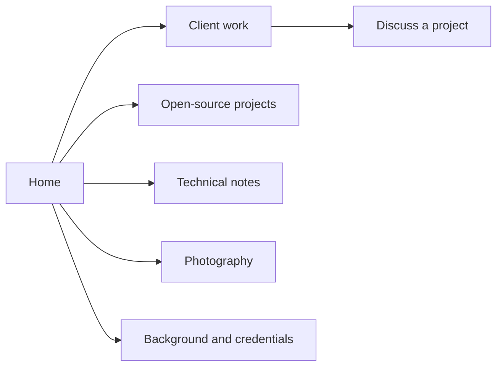

# Using the site

Nicholas Adamou builds software and websites. Explore his professional background,
client work, open-source projects, technical writing, and photography without an account.

## Find your way

- **Client work:** screenshots and links to websites built for businesses and creatives.
- **Projects:** open-source software and developer tools.
- **Notes:** articles about engineering, architecture, and tooling.
- **About:** work history, education, and résumé links.
- **Gallery:** photography; select an image to view it larger.
- **Contact:** describe your project and provide a reply address.

The bottom toolbar provides home, contact, and theme controls. Desktop visitors can
use `Cmd/Ctrl+K` for search, `Cmd/Ctrl+J` for chat, and `Shift+?` for shortcut help.
The theme picker supports light, dark, and custom colors.

## Contact and privacy

Use [the contact page](https://nicholasadamou.com/contact) to discuss work. Check the
[privacy policy](https://nicholasadamou.com/privacy) before submitting personal information.
If a service is unavailable, try again later. Chat responses can be inaccurate;
use the published pages to verify professional details.

## Reading with an agent

Start at [llms.txt](https://nicholasadamou.com/llms.txt) or the
[sitemap](https://nicholasadamou.com/sitemap.xml). Home, about, projects, clients,
notes, contact, and privacy support `Accept: text/markdown` at their normal URLs.
